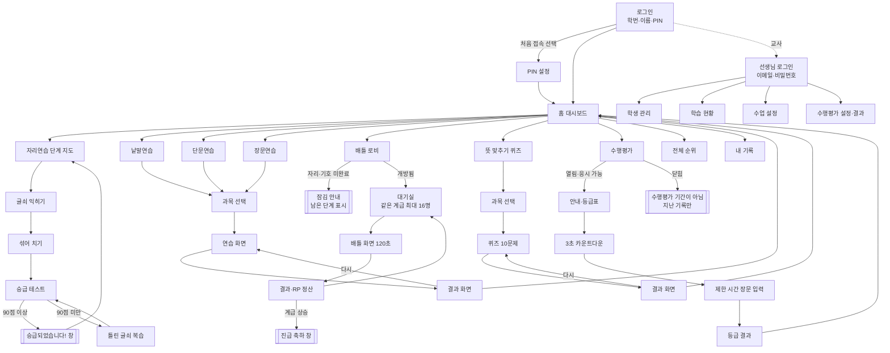

# 2. 화면 흐름도 및 와이어프레임

> 목적: 시선 이동을 최소화하는 화면 배치와 화면 간 이동 경로를 확정한다.
> 기준 해상도: 1366×768 이상 화면(학교 컴퓨터실). 데스크톱 PC·노트북·서피스 고3(타입 커버)를 지원하며, 모바일(터치)은 지원하지 않는다.

## 1. 설계 원칙

1. **시선은 위에서 아래로 한 줄**: 예시 글 → 입력창 → 가상 키보드가 화면 가운데 세로축에 놓인다. 타자 중 눈이 좌우로 움직이지 않는다.
2. **지표는 왼쪽 옆, 작게**: 타수·정확도·시간은 왼쪽 패널에 둔다. 치는 동안 숫자에 눈을 빼앗기지 않도록 크기를 키우지 않는다.
3. **내 위치는 항상 보인다**: 모든 화면 상단에 `이름 · 계급 · 자리연습 단계`가 표시된다.
4. **마우스 없이 진행**: 연습 시작·다음·다시 하기는 Enter/Space/Esc 로 가능하다.
5. **10분 수업에 맞춤**: 로그인 후 2번의 클릭 안에 타자를 시작할 수 있다.

## 2. 전체 화면 흐름도



## 3. 화면 목록

| # | 화면 | 경로 | 핵심 요소 |
|---|---|---|---|
| 01 | 로그인 | `/` | 학번, 이름, PIN, 처음 접속 선택, 선생님 모드 링크 |
| 02 | 홈 | `/home` | 오늘 목표(10분), 이어서 하기, 메뉴 4+4, 내 계급, 키보드 종류 설정 |
| 03 | 자리연습 단계 지도 | `/position` | 한글 8 + 기호 2 + 영문 7 단계, 현재 위치 표시 |
| 04 | 자리연습 | `/position/:stage` | 입력할 자리, 가상 키보드(데스크톱/노트북/서피스 고3 전환), 손 실루엣 |
| 05 | 승급 테스트 | `/position/:stage/test` | 문항 진행 막대, 문항 타이머 |
| 06 | 낱말연습 | `/word` | 낱말 + 뜻풀이, 입력창, 키보드 |
| 07 | 단문연습 | `/sentence` | 문장, 입력창, 키보드 |
| 08 | 장문연습 | `/passage` | 글(5줄 표시), 입력 줄, 진행률 |
| 09 | 결과 | (모달) | 타수·정확도·약점 글쇠·최고 기록 여부 |
| 10 | 배틀 로비/대기실 | `/battle` | 계급, 참가자 목록, 시작 버튼 |
| 11 | 배틀 | `/battle/:room` | 낙하 낱말, 입력창, 실시간 점수판 |
| 12 | 전체 순위 | `/ranking` | 탭 6종, 반/계급 필터, 내 순위 고정 |
| 13 | 내 기록 | `/me` | 성장 그래프, 약점 글쇠, 배지 |
| 14 | 선생님 모드 | `/teacher/*` | 학생 관리, 현황, 수행평가, 설정, 콘텐츠 올리기 |
| 15 | 뜻 맞추기 퀴즈 | `/quiz` | 과목·언어 선택, 뜻풀이, 보기 4개, 입력창, 문제 타이머, 점수·연속 |
| 16 | 수행평가 | `/exam` | 안내·등급표·내 기록, 카운트다운, 큰 남은 시간, 장문 입력(일시정지 없음), 등급 결과 |

## 4. 와이어프레임

### 4.1 로그인 (01)

```
┌──────────────────────────────────────────────────────────────┐
│                                                              │
│                    ⌨  타자 훈련소                             │
│              중1 정보 · 한글·영문 타자 연습                    │
│                                                              │
│              ┌────────────────────────────┐                  │
│              │ 학번   [ 1315            ] │                  │
│              │ 이름   [ 김민수          ] │                  │
│              │ PIN    [ ● ● ● ●        ] │                  │
│              │        [     입 장      ]  │                  │
│              └────────────────────────────┘                  │
│   처음 접속이면 "처음 접속"을 고르고 PIN 4자리를 새로 정합니다.  │
│                                              선생님 모드 →    │
└──────────────────────────────────────────────────────────────┘
```

- 학번은 4자리(학년 1 + 반 1 + 번호 2, 예: `1315` = 1학년 3반 15번).
- 학번·이름이 등록 명단과 다르면 "선생님께 등록을 요청하세요".
- Tab/Enter 만으로 입장할 수 있다.

### 4.2 홈 (02)

```
┌──────────────────────────────────────────────────────────────┐
│ ⌨ 타자 훈련소      3반 김민수 · 🎖 훈련병 · 자리 4/10   로그아웃 │
├──────────────────────────────────────────────────────────────┤
│ 오늘의 훈련  ████████░░░░░░  06:12 / 10:00     🔥 연속 5일     │
├──────────────────────────────────────────────────────────────┤
│ ▶ 이어서 하기: 자리연습 4단계 「가운데자리」            [Enter] │
├───────────────┬───────────────┬───────────────┬──────────────┤
│  자리연습      │  낱말연습      │  단문연습      │  장문연습     │
│  4 / 10 단계   │  최고 182타    │  최고 201타    │  최고 176타   │
├───────────────┼───────────────┼───────────────┼──────────────┤
│  ⚔ 배틀 모드🔒 │  🧠 뜻 퀴즈    │  🏆 전체 순위  │  📈 내 기록   │
│  자리 6단계 남음│  누적 320점    │  반 7위 · 41위 │  이번 주 +23타│
└───────────────┴───────────────┴───────────────┴──────────────┘
```

- 배틀이 잠겨 있으면 남은 단계 수를 보여 준다. 열리면 `현재 접속 8명 · 이등병 방`처럼 바뀐다.
- 홈 화면 설정에서 키보드 종류(데스크톱 키보드 / 노트북 키보드 / 서피스 고3)를 고른다. 선택은 브라우저에 기억된다.

### 4.3 자리연습 단계 지도 (03)

```
┌──────────────────────────────────────────────────────────────┐
│ ← 홈                 자리연습                   [한글] [영문]  │
├──────────────────────────────────────────────────────────────┤
│ 한글                                                         │
│  ✅──✅──✅──🟢──🔒──🔒──🔒──🔒──┬──🔒──🔒──▶ ⚔ 배틀 개방       │
│  기본 왼윗 왼아래 가운데 오윗 오아래 전체 숫자   기호1 기호2         │
│  100  96   92   지금                                         │
│                 여기!                                        │
├──────────────────────────────────────────────────────────────┤
│  4단계 가운데자리   ㅅ ㅛ ㅎ ㅗ ㅠ                             │
│  ① 글쇠 익히기 ✅   ② 섞어 치기 ⬜   ③ 승급 테스트 🔒           │
│                                    [ 연습 시작  Enter ]       │
└──────────────────────────────────────────────────────────────┘
```

- 통과한 단계에는 테스트 최고 점수를 적는다. 현재 단계는 크게, 색으로 강조한다.
- 같은 진행 막대의 축소판이 **자리연습 화면 왼쪽 패널에도 항상** 표시된다(요구사항 3: 자신의 단계를 알기 쉽게).

### 4.4 자리연습 (04) — 첨부 이미지 구성 기준

```
┌───────────────┬──────────────────────────────────────────────┐
│ ← 타자 연습으로 │                                 [한국어] ENG │
│               │                                              │
│   자리연습     │            ┌─────────────┐                    │
│  가운데자리    │            │  입력할 자리  │                    │
│   4 / 10      │            │             │     ㅎ    ㅛ    ㅗ   │
│ ✅✅✅🟢🔒🔒🔒🔒│            │     ㅅ      │   (다음 글쇠 3개)   │
│               │            └─────────────┘                    │
│   (캐릭터)     │                                              │
│               │  진행 ▓▓▓▓▓▓▓▓░░░░░░░░░░░░░░  12 / 40          │
│ 진행중 통계    │ ┌──────────────────────────────────────────┐ │
│ 진행시간 00:22 │ │ ~  1  2  3  4  5  6  7  8  9  0  -  =  ⌫ │ │
│ 정확도  95.0%  │ │ Tab ㅂ ㅈ ㄷ ㄱ[ㅅ]ㅛ ㅕ ㅑ ㅐ ㅔ [  ]  \ │ │
│ 오타    1      │ │ Caps ㅁ ㄴ ㅇ ㄹ ㅎ ㅗ ㅓ ㅏ ㅣ ;  '  Enter│ │
│               │ │ Shift ㅋ ㅌ ㅊ ㅍ ㅠ ㅜ ㅡ ,  .  /  Shift  │ │
│ ⌨● 키보드     │ │ Ctrl Alt [      Space      ] Alt Ctrl     │ │
│ ✋● 손 표시    │ │        (왼손 실루엣)   (오른손 실루엣)      │ │
└───────────────┴──────────────────────────────────────────────┘
```

구성 요소

| 요소 | 동작 |
|---|---|
| 입력할 자리 카드 | 지금 칠 글쇠를 크게 표시. 맞으면 왼쪽으로 밀려 나가고 다음 글쇠가 들어온다 |
| 다음 글쇠 3개 | 카드 오른쪽에 연하게 미리 보여 준다 |
| 가상 키보드 | 목표 글쇠를 진한 색으로, 현재 단계의 글쇠 전체를 연한 색으로 표시. 잘못 누른 글쇠는 0.3초 빨갛게 |
| 손 실루엣 | 반투명 회색 손 모양을 키보드 위에 겹친다. **눌러야 할 손가락만 진하게**, 그 손가락이 기본자리에서 목표 글쇠로 뻗는 모습으로 그린다. Shift 문항은 반대 손 새끼손가락도 함께 진하게 |
| 키보드 종류 | 데스크톱 키보드 / 노트북 키보드 / 서피스 고3(타입 커버)을 화면에서 전환한다(홈 화면 설정에서도 가능, 브라우저에 기억). 가상 키보드 그림의 맨 아랫줄(Fn, 한/영, 방향키 등)만 달라지고 판정은 같다. 아래 그림의 맨 아랫줄은 데스크톱 기준이다 |
| 표시 켜기/끄기 | 키보드(⌨)·손(✋) 표시를 각각 끌 수 있다. 끄고 연습하면 결과에 "안 보고 치기" 표시 |
| 한국어/ENG | 한글 트랙·영문 트랙 전환 |

손가락 배정(두벌식)

| 손가락 | 글쇠 열 |
|---|---|
| 왼손 새끼 | `1 ㅂ ㅁ ㅋ` + 왼쪽 Shift |
| 왼손 약지 | `2 ㅈ ㄴ ㅌ` |
| 왼손 중지 | `3 ㄷ ㅇ ㅊ` |
| 왼손 검지 | `4 5 ㄱ ㅅ ㄹ ㅎ ㅍ ㅠ` |
| 오른손 검지 | `6 7 ㅛ ㅕ ㅗ ㅓ ㅜ ㅡ` |
| 오른손 중지 | `8 ㅑ ㅏ ,` |
| 오른손 약지 | `9 ㅐ ㅣ .` |
| 오른손 새끼 | `0 - = ㅔ ; ' /` + 오른쪽 Shift, Enter |
| 엄지 | Space |

### 4.5 승급 테스트 (05) 와 승급 창

```
┌──────────────────────────────────────────────────────────────┐
│  승급 테스트 · 4단계 가운데자리          통과 기준 90점         │
│  문항  ▓▓▓▓▓▓▓▓▓▓▓▓░░░░░░░░  31 / 50      ○ ○ ● (남은 시간)   │
│                      ┌──────────┐                            │
│                      │    ㅛ    │                            │
│                      └──────────┘                            │
│        (가상 키보드: 배열만 표시, 강조·손 실루엣 없음)           │
└──────────────────────────────────────────────────────────────┘

        ┌────────────────────────────────────────┐
        │              🎉 승급되었습니다!          │
        │                                        │
        │      가운데자리  →  오른손윗자리         │
        │           테스트 점수  94점              │
        │   ✅✅✅✅🟢🔒🔒🔒 · 🔒🔒   (5 / 10 단계)  │
        │                                        │
        │   [ 다음 단계 시작 Enter ]   [ 홈으로 ]  │
        └────────────────────────────────────────┘
```

- 불합격 창: `아쉬워요! 86점 (4점 부족)` + 가장 많이 틀린 글쇠 3개 + `[틀린 글쇠 복습하기]`.
- 마지막 단계(기호 2) 통과 시: `🎖 자리연습 수료! 배틀 모드가 열렸습니다` 전용 창.

### 4.6 낱말·단문연습 (06, 07)

```
┌───────────────┬──────────────────────────────────────────────┐
│ ← 홈          │  과목 [섞어서▾]            7 / 30    [한국어] ENG│
│  낱말연습      │                                              │
│  과학          │   이전: 세포         ┌──────────┐   다음: 증발 │
│               │                      │  광합성   │             │
│ 현재 타수 186  │                      └──────────┘             │
│ 최고 타수 201  │   뜻: 식물이 빛을 이용해 양분을 만드는 과정      │
│ 정확도  97.2%  │                                              │
│ 진행시간 01:12 │            [ 광합ㅅ_                 ]         │
│               │                                              │
│ 약점: ㅛ ㅍ    │   (가상 키보드 — 다음에 칠 글쇠 강조, 끌 수 있음) │
└───────────────┴──────────────────────────────────────────────┘
```

- 낱말연습은 **뜻풀이를 함께** 보여 준다(어휘력 신장). 영어 낱말은 우리말 뜻을 보여 준다.
- 단문연습은 카드 자리에 한 문장이 놓이고, 입력한 글자가 예시 문장 위에 색으로 겹쳐 표시된다(정타 진하게, 오타 빨갛게).

### 4.7 장문연습 (08)

```
┌───────────────┬──────────────────────────────────────────────┐
│ ← 홈          │ 사회 · 민주주의와 시민            진행 34%     │
│  장문연습      │ ──────────────────────────────────────────── │
│               │  (지난 줄, 연하게) 민주주의는 국민이 주인이 되어  │
│ 현재 타수 172  │                                              │
│ 정확도  95.8%  │  ▶ 나라의 일을 스스로 결정하는 정치 제도이다.    │
│ 남은 시간 03:41│    [ 나라의 일을 스스로 결정하_          ]     │
│               │                                              │
│               │  (다음 줄, 연하게) 오늘날 대부분의 나라는 ...    │
│               │  (다음 줄, 연하게) ...                         │
└───────────────┴──────────────────────────────────────────────┘
```

- 현재 줄은 화면 세로 가운데에 고정하고 글이 위로 흘러간다. 눈 위치가 변하지 않는다.
- 장문에서는 가상 키보드를 기본으로 숨긴다(화면을 보고 치는 습관).

### 4.8 결과 창 (09)

```
        ┌────────────────────────────────────────┐
        │   단문연습 완료!        🏅 최고 기록 갱신 │
        │   타수  201타/분 (▲19)   정확도  96.4%   │
        │   오타  7개              시간   02:48    │
        │   약점 글쇠:  ㅛ(3)  ㅍ(2)  ㅖ(2)         │
        │   획득:  ⭐ 경험치 +24                    │
        │  [다시 Enter]  [약점 글쇠 연습]  [홈 Esc] │
        └────────────────────────────────────────┘
```

### 4.9 배틀 대기실·배틀·결과 (10, 11)

```
대기실
┌──────────────────────────────────────────────────────────────┐
│ ⚔ 배틀 · 이등병 방                       참가 9 / 16          │
│  김민수(나)  이서연  박지호  최유나  정하준  ...               │
│  방장: 이서연        [ 시작 대기 중... ]   (방장만 [시작])     │
└──────────────────────────────────────────────────────────────┘

배틀
┌─────────────────────────────────────────────┬────────────────┐
│ 남은 시간 01:24                              │ 순위           │
│        광합성                                │ 1 이서연  14   │
│                     지구 온난화(금색)         │ 2 김민수  12   │
│   나라(회색)                                 │ 3 박지호   9   │
│                              민주주의        │ 4 최유나   8   │
│           세포                               │ …              │
│ ───────────────── 바닥 ───────────────────  │                │
│        [ 민주주ㅇ_              ]            │ 내 점수 12     │
└─────────────────────────────────────────────┴────────────────┘

결과
┌──────────────────────────────────────────────────────────────┐
│  🥈 2등 / 9명        획득 RP +19      이등병 ▓▓▓▓▓▓░░ 212/300  │
│  1 이서연 14점  2 김민수 12점  3 박지호 9점 ...              │
│  [ 한 판 더 Enter ]   [ 나가기 Esc ]                          │
└──────────────────────────────────────────────────────────────┘
```

- 다른 사람이 낱말을 가져가면 그 사람 이름표가 낱말 위에 잠깐 뜨고 사라진다.
- 배틀에서는 가상 키보드를 표시하지 않는다.

### 4.10 전체 순위 (12)

```
┌──────────────────────────────────────────────────────────────┐
│ 🏆 전체 순위 [배틀][퀴즈][한글 타수][영문 타수][성실][이번 주 성장] │
│ 범위 [전체▾] [1반▾]                                           │
├──────────────────────────────────────────────────────────────┤
│ ★ 내 순위   41위   3반 김민수   훈련병   RP 68                 │
├──────────────────────────────────────────────────────────────┤
│  1   2반 이서연   병장     RP 1,120                           │
│  2   5반 박지호   상병     RP 870                             │
│  ...                                                         │
└──────────────────────────────────────────────────────────────┘
```

### 4.11 내 기록 (13)

```
┌──────────────────────────────────────────────────────────────┐
│ 📈 내 기록                                                    │
│ ┌ 타수 성장 그래프(주별, 한글/영문) ┐ ┌ 약점 글쇠 키보드 지도 ┐ │
│ │        ／￣                      │ │ 틀린 비율이 높은 글쇠  │ │
│ │   ＿／                           │ │ 일수록 진한 빨강       │ │
│ └──────────────────────────────────┘ └────────────────────────┘ │
│ 연습 달력(잔디)  🔥 연속 5일      배지: 🏅×6                    │
└──────────────────────────────────────────────────────────────┘
```

### 4.12 선생님 모드 (14)

```
┌──────────────────────────────────────────────────────────────┐
│ 선생님 모드  [학생 관리] [학습 현황] [수업 설정] [콘텐츠 올리기] 로그아웃 │
├──────────────────────────────────────────────────────────────┤
│ 학생 관리   반 [3반▾]   [+ 학생 추가] [엑셀 일괄 등록] [내보내기]│
│  학번    이름    자리단계  계급   한글타수  최근접속   관리      │
│  1301   강지우   7/10    훈련병   164    11/20    [PIN초기화][삭제]│
│  1302   김민수   4/10    훈련병   121    11/22    [PIN초기화][삭제]│
├──────────────────────────────────────────────────────────────┤
│ 학습 현황   반 평균 타수 · 단계 분포 막대 · 오늘 미참여 학생     │
│ 수업 설정   배틀 허용 [ON/OFF] · 하루 목표 시간 [10분] ·        │
│            승급 통과 점수 [90] · 순위표 공개 [ON/OFF]           │
└──────────────────────────────────────────────────────────────┘
```

| 기능 | 내용 |
|---|---|
| 학생 추가 | 학번·이름 입력(1명) 또는 엑셀/CSV 붙여넣기로 일괄 등록 |
| 학생 삭제 | 확인 창(이름 다시 입력) 후 삭제. 기록도 함께 삭제됨을 안내 |
| PIN 초기화 | 학생이 PIN 을 잊었을 때. 교사가 `secrets/{학번}` 을 지우면 다음 접속 시 "처음 접속"으로 새로 정함 |
| 교사 초대 | 처음 가입한 교사가 관리자가 되고, 관리자가 다른 교사의 이메일을 초대한다 |
| 콘텐츠 올리기 | 콘텐츠 JSON 파일을 올려 Firestore 에 저장한다. 올린 콘텐츠는 로그인한 학생·교사만 읽는다 |
| 단계 조정 | 전학생·결석생 등을 위해 교사가 단계 수동 변경 가능 |
| 내보내기 | 반별 성적(단계, 타수, 정확도, 연습 일수)을 CSV 로 저장 |
| 실시간 현황 | 지금 접속한 학생과 현재 하고 있는 연습을 한 화면에서 확인 |
| 수행평가 | `/teacher/exam` 탭. 열기/닫기·언어·제한 시간·응시 횟수·지문 설정, 등급표, 반별 결과 표·등급 분포, 응시 기회 초기화, CSV 내보내기 |

### 4.13 뜻 맞추기 퀴즈 (15)

```
┌───────────────┬──────────────────────────────────────────────┐
│ ← 홈          │  과목 [섞어서▾]            3 / 10    [한국어] ENG│
│  뜻 맞추기     │                                              │
│               │   뜻: 식물이 빛을 이용해 양분을 만드는 과정      │
│ 점수     38   │                                              │
│ 연속   🔥 2   │     광합성    증발    세포    호흡              │
│ 남은 시간 09초 │   ▓▓▓▓▓▓▓▓▓░░░░░░  (문제당 15초)              │
│               │                                              │
│               │            [ 광합ㅅ_                 ]         │
└───────────────┴──────────────────────────────────────────────┘
```

- 보기 4개 중 정답을 입력창에 직접 쳐서 Enter 로 답한다. 정답이면 초록, 오답이면 빨강으로 정답을 1초 보여 준다.
- 한 판 10문제가 끝나면 결과 창(09)에 점수·정답 수·획득 경험치를 보여 준다. 점수 규칙은 1번 문서 7장.

### 4.14 수행평가 (16)

```
안내:  📝 1학기 타자 수행평가   언어[한글|영어]  제한 3분  응시 0/2
       등급표 A 200타 이상 … E 110타 미만   내 기록
       ⚠ 시작하면 멈출 수 없습니다 · 가장 좋은 기록 인정 · 붙여넣기 불가   [평가 시작 Enter]
응시:  ┌ 📝 제목        남은 시간 02:41(큼)        타수·정확도·오타(작게) ┐
       │      (지난 줄, 연하게)
       │  ▶ 현재 줄 (세로 가운데)  [ 입력창 ]
       │      (다음 줄, 연하게)
결과:  큰 등급 글자(A~E) · 최종 타수 · 정확도 · 오타 · 등급표에서 내 위치 · 다음 등급까지 n타 더 · [확인 Enter][다시 응시]
```

- 응시 화면은 장문연습(4.7)과 같은 줄 단위 입력이다. Esc 는 무시하고, 창을 벗어나면 경고만 띄운다. 규칙은 1번 문서 8장.
- 평가가 닫혀 있으면 "지금은 수행평가 기간이 아닙니다"와 지난 내 기록만 보여 준다. 홈에는 열려 있을 때 "수행평가 진행 중" 띠가 뜬다.

## 5. 공통 UI 규칙

| 항목 | 규칙 |
|---|---|
| 색 | 민트 계열 주색(첨부 이미지 톤), 오타는 빨강, 정타는 진한 남색. 색만으로 구분하지 않고 밑줄·흔들림을 함께 쓴다 |
| 글꼴 | 예시 글·입력창은 자모 구분이 뚜렷한 고딕 계열(예: Pretendard), 예시 글 28px 이상 |
| 단축키 | Enter 시작/다음, Esc 일시정지/나가기, F2 소리 켜기/끄기 |
| 키보드 종류 | 데스크톱 키보드 / 노트북 키보드 / 서피스 고3(타입 커버) 중 학생이 선택. 홈 화면 설정과 자리연습 화면에서 전환하고 브라우저에 기억한다. 가상 키보드 그림의 맨 아랫줄만 달라진다 |
| 소리 | 기본값 꺼짐(교실 환경). 이어폰 사용 시 켤 수 있음 |
| 접근성 | 움직임 줄이기 설정 시 낙하·흔들림 효과 약화 |
